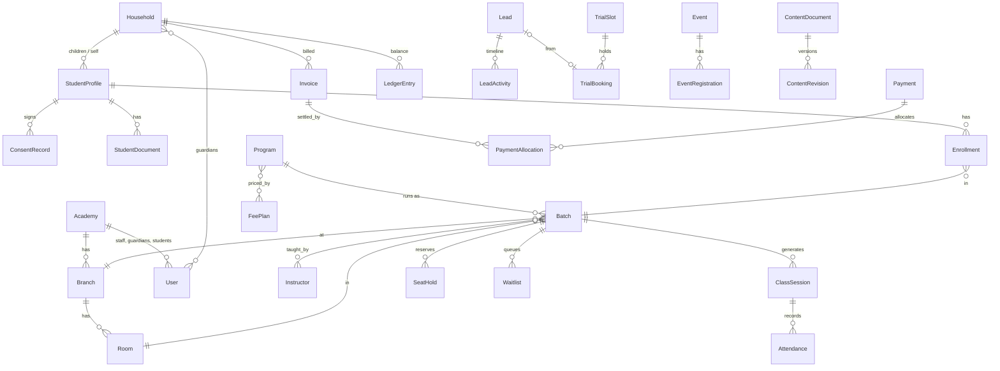

# Database

MongoDB (Atlas, Mumbai `ap-south-1` in production; a local single-node replica set in development) via Mongoose 9.

**Status key:** ✅ implemented · 🔜 planned for the phase shown. Planned collections are designed here so later phases don't need migrations.

## Conventions
- Every business collection has `academyId` (added and enforced by `tenantPlugin`), `createdAt`, `updatedAt`.
- Unique indexes are compound with `academyId`.
- References are `ObjectId`s, except IDs stored on Better Auth users (strings, as Better Auth stores them).
- Money: integer **paise** + the academy's ISO currency. Percentages: basis points (`1800` = 18%).
- Time: UTC `Date`s. Recurring schedules: `"HH:mm"` strings in the branch's IANA timezone.
- Soft delete (`deletedAt`) for records others reference; hard delete only for drafts and unused media.
- Financial and consent records are **append-only**; corrections are new records.
- Large or growing lists live in their own collection (activities, revisions, ledger), never in an unbounded array.

## Relationships

## Collections

### Identity & organisation
| Collection | Status | Key fields | Indexes / invariants |
|---|---|---|---|
| `academies` | ✅ | slug, name, legalName, currency, locale, timezone, financialYearStartMonth, tax {enabled, label, registrationNumber, rateBps, pricesIncludeTax}, contact, address | `slug` unique. Tenant root — not tenant-filtered. |
| `users` (Better Auth) | ✅ | email, name, emailVerified, role, academyId, branchIds[], householdId, instructorId, studentId, status, phone | `email` unique. Privileged fields not settable at sign-up. |
| `sessions`, `accounts`, `verifications`, `ratelimits` (Better Auth) | ✅ | session tokens, password hashes (in `accounts`), verification tokens, auth rate limits | Managed by Better Auth. |
| `branches` | ✅ | name, slug, code, timezone, address, location (GeoJSON), phone, email, whatsapp, businessHours[], facilities[], isActive, sortOrder, deletedAt | `{academyId, slug}` unique, `{academyId, code}` unique, `location` 2dsphere |
| `rooms` | ✅ | branchId, name, capacity, areaSqFt, features[], isActive | `{academyId, branchId, name}` unique |
| `facilityblocks` | ✅ | branchId, roomId?, instructorId?, reason, start/end (UTC) or recurrence | `{academyId, roomId, start}`, `{academyId, instructorId, start}` |
| `holidays` | ✅ | branchId? (null = academy-wide), date (`YYYY-MM-DD`), name | `{academyId, date}` |
| `staffprofiles` | 🔜 P3 | userId, title, phone, emergency contact | `{academyId, userId}` unique |

### People, consent & documents
| Collection | Status | Key fields | Indexes / invariants |
|---|---|---|---|
| `households` | ✅ | name, guardians [{userId, name, email, relationship, isPrimary}], billing {name, line1, city, state, postalCode, email, phone}, preferredChannel, branchIds[] (empty until first enrolment), internalNotes (staff only), deletedAt | `{academyId, 'guardians.userId'}`, `{academyId, branchIds}`, `{academyId, name}`. Branch staff also see households with no branch yet (new sign-ups). Credit balance arrives with finance (P9). |
| `studentprofiles` | ✅ | householdId, userId? (adults today; teen logins later), name, dob ("YYYY-MM-DD" string), gender?, photo, levels [{style, level}], medicalNotes (**`select: false`**, restricted), emergencyContacts [{name, relationship, phone}], status, isSelf, branchIds[], deletedAt | `{academyId, householdId}`, `{academyId, branchIds, status}`, `{academyId, name}`. Medical notes never come back from a query unless the service asks for them after a permission check. |
| `instructors` | ✅ | userId, slug, bio, specialties[], experienceYears, achievements[], socials, photo, isPublic, availability [{weekday, start, end, branchId}], payNotes (restricted) | `{academyId, slug}` unique |
| `consenttemplates` | ✅ | key (stable across versions), version, type, title, body (plain text with `##` / `-` mini-markup), requiredFor[] (enrolment/events/trials), isActive, supersededAt | `{academyId, key, version}` unique; **one current version per key** (partial unique on `supersededAt: null`). Editing the wording writes version N+1. |
| `consentrecords` | ✅ | studentId, householdId, templateId, templateKey, templateType, version, signedBy, typedName, scopes[] (website/social/print/video), ip, userAgent, signedAt, onBehalf (staff recorded a paper form), revokedAt/By/ByName/Reason | **Append-only**: only the revocation fields can ever be written; deletes, replaces and other updates are refused. Unique `{academyId, studentId, templateKey, version}` while not revoked (a double-click can't sign twice). |
| `studentdocuments` | ✅ | studentId, householdId, type, label, provider (local/cloudinary), storageKey, mime, bytes, originalName, uploadedBy(+Name), verifiedBy(+Name)/At, expiresOn, notes, deletedAt | `{academyId, studentId}`, sparse `{academyId, expiresOn}`. Files are private: served only by `/api/documents/[id]` after a permission check. |

### Catalogue & schedule
| Collection | Status | Key fields | Indexes / invariants |
|---|---|---|---|
| `programs` | ✅ | slug, title, style, summary, body, media, level, ageMin/Max, durationWeeks, mode (offline/online/hybrid), prerequisites, requiredDocuments[], requiredConsents[], instructorIds[], feePlanIds[], seo, status | `{academyId, slug}` unique, `{academyId, status, style}` |
| `feeplans` | ✅ | name, type (monthly/term/course/class_pack/drop_in), amount, registrationFee, billingDay, prorationRule, lateFeeRule, siblingDiscountEligible, version, effectiveFrom, supersededBy | `{academyId, planKey, version}` unique; versions immutable once used |
| `batches` | ✅ | programId, branchId, roomId, instructorIds[], level, ageMin/Max, capacity, enrolledCount (display), seatVersion (lock), startDate, endDate, schedule [{weekday, startTime, endTime}], feePlanIds[], meetingUrl?, enrollmentOpen, status | `{academyId, branchId, status}`, `{academyId, programId}`, `{academyId, instructorIds}` |
| `classsessions` | ✅ | batchId, branchId, roomId, instructorId, substituteId?, startsAt, endsAt (UTC), timezone, status, notes | `{academyId, batchId, startsAt}` unique, `{academyId, roomId, startsAt}`, `{academyId, instructorId, startsAt}` |
| `trialslots` | 🔜 P7 | programId, branchId, roomId, sessionId?, startsAt, endsAt, capacity | `{academyId, programId, startsAt}` |

### Operations
| Collection | Status | Key fields | Indexes / invariants |
|---|---|---|---|
| `enrollments` | ✅ | studentId, householdId, batchId, programId, branchId, feePlanKey + feePlanVersion, status, startDate, endDate, source (web/staff/trial/waitlist/transfer), note, transferredFromId, history[] {status, at, by, byName, note} | **Partial unique** `{academyId, studentId, batchId}` where status ∈ {pending, active, paused}; `{academyId, batchId, status}`, `{academyId, householdId, status}`. Pending, active and paused all occupy a seat. |
| `seatholds` | ✅ | batchId, studentId, householdId, kind (checkout/waitlist_offer), expiresAt, createdBy | Unique `{academyId, batchId, studentId}`; TTL on `expiresAt` (+24 h, tidy-up only); **counted only while `expiresAt > now`**, so an expired hold stops counting by itself. |
| `waitlists` | ✅ | batchId, studentId, householdId, priority, status, joinedAt, offeredAt, offerExpiresAt, resolvedAt, note | `{academyId, batchId, status, priority, joinedAt}`; partial unique per student+batch while waiting/offered. Position is computed (priority, then join time), never stored. |
| `trialbookings` | 🔜 P7 | slotId, leadId, studentName, dob, guardian {name, phone, email}, status, policyVersionId, invoiceId? | Partial unique `{academyId, phone, programId, day}` while active |
| `attendance` | 🔜 P8 | sessionId, batchId, studentId, status, markedBy, markedAt, deviceAt, source (roster/qr/offline), corrections[] | `{academyId, sessionId, studentId}` unique (idempotent upsert) |
| `makeupcredits` | 🔜 P8 | studentId, sourceSessionId, expiresAt, redeemedSessionId? | `{academyId, studentId, expiresAt}` |
| `memberships` | 🔜 P9 | householdId, studentId?, planId, periodStart, periodEnd, autoRenew, status | `{academyId, periodEnd, status}` |
| `certificates` | 🔜 P9 | studentId, programId, title, issuedAt, code, pdfAsset | `code` unique (public verification) |

### Finance
| Collection | Status | Key fields | Indexes / invariants |
|---|---|---|---|
| `invoices` | 🔜 P9 | number, householdId, branchId, studentIds[], issueDate, dueDate, lines [{kind, description, feePlanId, version, period, qty, unitPrice, discount, tax, total}], subtotal, discountTotal, taxTotal, total, amountPaid, balance, status | `{academyId, number}` unique, `{academyId, householdId, status}`, `{academyId, dueDate, status}`. Issued invoices immutable (void/credit note only). |
| `payments` | 🔜 P9 | receiptNumber, householdId, branchId, amount, method, reference, receivedAt, receivedBy, idempotencyKey, status, reversalOf? | `{academyId, idempotencyKey}` unique, `{academyId, receiptNumber}` unique |
| `paymentallocations` | 🔜 P9 | paymentId, invoiceId, amount | `{academyId, invoiceId}`, `{academyId, paymentId}`; Σ allocations ≤ payment and ≤ invoice total |
| `creditnotes` | 🔜 P9 | number, invoiceId, amount, reason, issuedBy | `{academyId, number}` unique |
| `refunds` | 🔜 P9 | paymentId, invoiceId?, amount, reason, policyCalculation, status (requested/approved/rejected/paid), requestedBy, approvedBy, method, reference | `{academyId, status}`; amount ≤ refundable |
| `ledgerentries` | 🔜 P9 | householdId, type, amount (signed), refType, refId, at | `{academyId, householdId, at}`; append-only; household balance = Σ amount |
| `coupons` / `couponredemptions` | 🔜 P9 | code, kind, value, scope, limits, dates / couponId, householdId, invoiceId | `{academyId, code}` unique; per-household limit via redemption count |
| `policies` | 🔜 P9 | type, version, rules [{minNoticeHours, refundBps, creditBps}], nonRefundable[], text | `{academyId, type, version}` unique |
| `counters` | ✅ | key, seq | `{academyId, key}` unique. Incremented inside the caller's transaction (gap-free). |
| `idempotencykeys` | 🔜 P9 | key, scope, requestHash, result, expiresAt | `{academyId, scope, key}` unique, TTL |

### Events, CRM & marketing
| Collection | Status | Key fields | Indexes / invariants |
|---|---|---|---|
| `events` | ✅ (public fields; tiers & registrations P10) | slug, type, title, body, guestArtist, startsAt, endsAt, venue {branchId, roomId, external}, poster, tiers [{name, price, capacity, sold}], registrationDeadline, requiredConsents[], status | `{academyId, slug}` unique, `{academyId, startsAt, status}` |
| `eventregistrations` | 🔜 P10 | eventId, tier, studentId?, attendee {name, phone, email}, invoiceId, checkedInAt, status | Partial unique `{academyId, eventId, tier, studentId}` while active |
| `leads` | 🔜 P7 | name, phone, email, source, utm, landingPage, interest {programId, branchId}, status, lostReason, ownerId, nextFollowUpAt, convertedHouseholdId | `{academyId, phone}`, `{academyId, email}`, `{academyId, status, nextFollowUpAt}`, `{academyId, ownerId}` |
| `leadactivities` | 🔜 P7 | leadId, type (note/call/whatsapp/email/status), body, by, at | `{academyId, leadId, at}` |
| `contactinquiries` | ✅ (CRM view P7) | name, phone, email, topic, message, leadId, status | `{academyId, createdAt}` |
| `subscribers` | 🔜 P10 | email, status (pending/confirmed/unsubscribed), tokens | `{academyId, email}` unique |
| `referrals` | 🔜 P9 | referrerHouseholdId, code, refereeHouseholdId, rewardStatus | `{academyId, code}` unique |
| `banners` | 🔜 P10 | kind (announcement/promo), content, audience, pages[], startsAt, endsAt, priority | `{academyId, startsAt, endsAt}` |

### Content
| Collection | Status | Key fields | Indexes / invariants |
|---|---|---|---|
| `contentdocuments` | ✅ | kind (page/navigation/brand/seo), key (page slug, or `main`), title, system, draft {data, version, updatedBy, updatedByName, updatedAt}, published {data, revision, publishedAt, publishedByName}, schedule {publishAt, unpublishAt, byName}, editing {userId, name, at}, mediaIds[], revisionCount, deletedAt | `{academyId, kind, key}` unique; `draft.version` for optimistic concurrency (a save names the version it started from); sparse indexes on `schedule.publishAt` / `schedule.unpublishAt` for the job; `{academyId, mediaIds}` for "where is this file used" |
| `contentrevisions` | ✅ | documentId, number, data, note, changes[], createdBy, createdByName, createdAt | `{academyId, documentId, number}` unique; immutable (updates, replaces and re-saves are refused) |
| `redirects` | ✅ | from, to, permanent, hits, note | `{academyId, from}` unique; renaming a page upserts one and removes any that would loop |
| `mediaassets` | ✅ | provider (cloudinary/local), storageKey, url, kind, format, mime, width, height, bytes, originalName, alt, caption, focalX/Y, folder, tags[], uploadedBy | `{academyId, createdAt}`, `{academyId, folder, createdAt}`, `{academyId, tags}`, `{academyId, url}`; delete refused while any page, program, instructor, event, gallery item or review uses it |
| `testimonials` | ✅ | authorName, relation (student/parent/alumni), programTitle, rating, quote, youtubeId, photoUrl, featured, sortOrder, status (pending/approved/rejected), source (staff/website), contact (never public), consentAt, ip, studentIds[] | `{academyId, status, featured, sortOrder}`; only approved reviews can be featured; student media-consent check arrives with students (P6) |
| `galleryitems` | ✅ | kind (image/video), src, youtubeId, poster, alt, caption, category, status (published/hidden), sortOrder, studentIds[] | `{academyId, status, category, sortOrder}`; files referenced by URL from the media library; student media-consent check arrives with students (P6) |

### System
| Collection | Status | Key fields | Indexes / invariants |
|---|---|---|---|
| `auditlogs` | ✅ | actorId, actorRole, actorName, action, entity, entityId, branchId, changes {before, after}, meta, ip, userAgent, requestId, createdAt | `{academyId, createdAt}`, `{academyId, entity, entityId, createdAt}`, `{academyId, actorId, createdAt}`, TTL 3 years. Updates/deletes refused. |
| `ratelimits` (app) | ✅ | key, count, expiresAt | `key` unique, TTL on `expiresAt`. Not tenant-scoped. |
| `notifications` | 🔜 P10 | type, channel, recipient {userId, email, phone}, payload, dedupeKey, status, attempts, nextAttemptAt, lockedUntil, providerMessageId, lastError, deliveredAt | `{academyId, dedupeKey}` unique, `{status, nextAttemptAt}` |
| `notificationtemplates` | 🔜 P10 | type, channel, subject, body, variables[], providerTemplate, isEnabled | `{academyId, type, channel}` unique |
| `notificationpreferences` | 🔜 P10 | userId, channels {email, whatsapp, push}, whatsappOptInAt, quietHours | `{academyId, userId}` unique |
| `analyticsevents` / `analyticsdaily` | 🔜 P11 | type, path, section, country, region, referrer, utm, device, at / date, dimensions, counts | TTL 90 days on raw events; `{academyId, date}` on rollups |
| `jobs` | 🔜 P12 | kind (export/backup), status, requestedBy, file, expiresAt | `{academyId, createdAt}` |
| `datarequests` | 🔜 P12 | kind (export/delete), subject, status, approvedBy | `{academyId, status}` |

## Concurrency patterns
- **Capacity (seats, trial slots, event tiers):** in a transaction, increment the parent's lock field (`seatVersion`), count active + held, insert if below capacity. Concurrent transactions on the same parent conflict and the driver retries one, so they serialise. No counter can drift; the stored count is display-only and reconciled nightly.
- **Scheduling conflicts:** the same lock technique per room per day while checking overlaps.
- **Idempotency:** unique keys (`idempotencyKey`, `dedupeKey`, `{sessionId, studentId}` for attendance) make retries and offline replays safe.
- **Numbering:** `counters` incremented inside the transaction that issues the number.

## Backups
Atlas continuous backup / point-in-time restore on a production tier, plus a nightly encrypted `mongodump` to object storage kept 30 days, and a monthly scripted restore check (Phase 12, `docs/BACKUP.md`).
